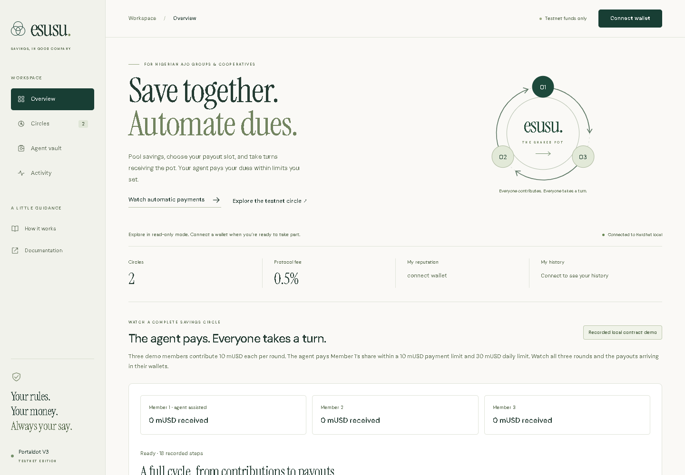
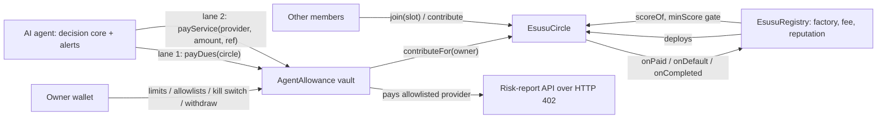

# On-chain Esusu-agent

**For Nigerian ajo groups and cooperatives: save together, take turns receiving the pot, and let an agent pay your dues within limits you control.**

   

Built for the **Portaldot Hacker House 2026** (Ecosystem DApps). **Status: deployed and verified on Portaldot V3 testnet**, with 12 finalized deployment and setup transactions (see [Status](#status-read-this-first)).

| Try it | How |
|---|---|
| **Live app** | [Open the dapp on Vercel](https://onchainesusuagent.vercel.app) or run `npm run web` locally (see [docs/DEPLOY.md](docs/DEPLOY.md)). |
| **Watch automatic payments and payouts—no wallet or faucet** | [Watch the recorded local contract demo](https://onchainesusuagent.vercel.app/#demoSection). About 45 seconds, with downloadable transaction receipts. |
| **60-second local demo, no wallet or tokens needed** | `npm install && npm run demo:local`, then open http://127.0.0.1:5173 ([judge guide](docs/JUDGES.md)) |
| **Prove it works** | `npm test` (113 tests incl. 40 randomized circles) · `npm run e2e` (real browser) |

[Full workspace](docs/dapp-e2e.png) · [Mobile layout](docs/dapp-mobile.png)

## Understand it in 10 seconds

- **Who:** Nigerian friend-and-family ajo/esusu groups, and cooperatives that organize them.
- **Problem:** missed contributions and members who stop paying after receiving the pot.
- **Product:** a shared savings circle on Portaldot with a fixed payout order, collateral for missed dues, and an agent that automates contributions within owner-set limits.

Earlier payout slots require more collateral to cover the member's remaining dues. The agent can only pay approved circles and providers; it cannot withdraw from the vault. Late-slot defaults can still reduce later pots, so this is not a guarantee against every loss. [How the safeguards work](docs/AUDIT.md).

## Watch a complete cycle without testnet gas

The hosted app includes an explicitly labelled **recording of real local contract transactions**: three members make nine contributions, the actual agent pays the owner's three contributions and settles all three rounds, and the demo wallets claim every payout and collateral refund. Each 30 mUSD pot pays 29.85 mUSD to its recipient plus a 0.15 mUSD protocol fee. The circle ends with zero funds. Member 1 also owns the treasury, so that wallet receives the fees.

This is a replay, not a live Portaldot run. It works without a wallet, faucet or background agent service. Reproduce it using `npm install` then `npm run demo:record`; the command uses a fresh local Hardhat chain, the same Solidity contracts and the real agent decision loop, and saves the receipts to `web/demo-recording.json`.

The November 1 testnet preparation created two local demo wallets, minted their test mUSD and approved their contributions. The circle remains open with 1/3 members: both remaining joins estimate about 31.24 tPOTv3 combined, before contributions and settlement. Further testnet spending is deferred because more faucet tokens are unavailable. [Preparation receipts](deployments/portaldot-demo.json) are separate from the local recording; the private demo keys remain git-ignored.

## Status (read this first)

| Piece | State |
|---|---|
| 3 contracts (`EsusuCircle`, `EsusuRegistry`, `AgentAllowance`) | Built. 113 tests incl. 40 randomized full circles checking solvency after every transaction. Unaudited. |
| Agent (decision core, auto-discovery, Telegram alerts, risk grader) | Built and tested against a real local chain. |
| Paid API: agent buys a risk report over HTTP 402 from its capped vault | Built and tested end to end (local). |
| Dapp (read-only mode, slot picker, risk grade, stablecoin flows, vault controls) | Built. 56 checks pass in headless Chromium against a local chain. |
| One-command judge demo with seeded circles, a defaulter, a gated circle and a live agent | Built and run end to end on a local chain. |
| **Portaldot testnet deployment** | **Deployed and verified October 24.** Registry, demo mUSD, circle and agent vault have contract code on chain 420420777. All 12 deployment/setup transactions are finalized. See [deployment evidence](deployments/portaldot.json). |
| Portaldot **WASM / ink!** | **Not used.** Shown honestly as roadmap, not claimed. |
| Third-party audit | Not done. Self-audit log: [docs/AUDIT.md](docs/AUDIT.md). |

## Testnet deployment proof

Network: **Portaldot V3 Testnet**, chain ID **420420777**. Explorer: https://node-console.portaldot.dev/.

| Contract | Address |
|---|---|
| EsusuRegistry | `0x317a5d7D429221CcD383fFAb87e81b0D5C12d602` |
| MockToken (test mUSD, 6 decimals) | `0x3288B56279A6F299e7B82886e76E7822A3019138` |
| EsusuCircle | `0xeba280DD133D38852b7b58e4ECf4B29BCFaDBd1d` |
| AgentAllowance vault | `0x98017f2275B6758791687e0916cFc4933351482E` |

Registry deployment transaction: `0xb227a40604be4783d1d0de7d2b47503f952c00158bcc3370b43bb1d03b73734e`, block **179978**. All transaction hashes, receipts, code hashes and final configuration are recorded in [deployments/portaldot.json](deployments/portaldot.json).

At the **October 24, 2026, 21:33:46 UTC** verification snapshot (finalized block **180016**), the demo circle was Open with **1 of 3 members** joined, 10 mUSD dues and 15-minute rounds. The vault held **50 test mUSD**, its separate agent was configured, and the circle and service payee were allowlisted. A complete multi-member cycle has been tested locally; the testnet circle starts once the other two slots are filled.

**Judge testing window:** the owner renewed the agent policy on **November 1** for 30 days, until **December 1, 2026 at 15:37:18 UTC (16:37:18 Lagos)**. The 10 mUSD per-payment and 30 mUSD daily limits are unchanged. Renewal transaction: `0xb4c9cc7d34bd5fbdaa09255b0094613ddccedca0d8715210e599b8aafaa9b71b`, confirmed in block **279265**; receipt and policy values are in the [deployment record](deployments/portaldot.json). This renews spending permission; the agent process still needs to be running to pay dues.

The 12 receipts account for **2438.7171 tPOTv3** in fees including storage deposits, plus **0.1 tPOTv3** transferred to the agent. The recorded owner balance after setup was **61.0829 tPOTv3**. The earlier funding blocker is resolved; see the [deployment guide](docs/DEPLOY.md) for the measurements and current usage instructions. Mock mUSD has unrestricted minting and no monetary backing.

To inspect the deployed circle, open https://onchainesusuagent.vercel.app, or run `npm install` and `npm run web`, then open http://localhost:5173. The committed configuration selects the testnet registry without requiring a wallet. Vercel builds from the repository root and serves `web/`; GitHub Pages is an optional separate host. Use `npm run demo:local` for the separate seeded local rehearsal.

## How it works

**Slot-priced collateral.** In a circle of `n`, slot `s` (0 = paid first) locks `dues × max(1, n−1−s)`. After being paid, a member still owes `n−1−s` more rounds, which the collateral covers exactly. The randomized tests check this holds after every transaction.

## Both ideas, fully built

| Idea | What was asked | Where it is |
|---|---|---|
| **1. Esusu / ajo on-chain** | Rotating savings, escrowed contributions, payout order, default penalties | Circles with chosen payout slots, collateral, slashing, strike rule, pull payouts, ERC-20 stable dues, leave-before-start, reputation gating, 0.5% fee (cap 2%) |
| **2. Agent allowance** | Wallet for AI agents with spend limits, whitelisted targets, kill switch, a demo agent that **pays for APIs** | `AgentAllowance`: per-payment and per-period caps, per-provider caps, allowlists, expiry, pause, can't pay itself. Demo agent pays a risk-report API over HTTP 402 (`npm run demo:buy`) |

## What the agent can and cannot do (enforced on-chain)

| Can | Cannot |
|---|---|
| Pay your dues into circles **you** allowlisted (amount read from the circle, beneficiary always you) | Choose that amount, or pay anyone for you but you |
| Pay providers **you** allowlisted, within per-payment, per-provider and per-period caps | Pay an address you did not allowlist, or **itself** |
| Settle finished rounds (anyone can) and alert you early | Withdraw, change limits, un-pause, allowlist anything, or make vault payments after expiry |
| | Worst case if its key is stolen: your own dues pre-paid and payments to trusted providers, bounded by the shared cap in each spending period until paused or expired |

## What we contribute to the Portaldot ecosystem

1. **A `0x…` → native `5…` address helper**, verified byte-for-byte against the official guide's example ([`lib/portaldot.js`](lib/portaldot.js)). Newcomers need this just to claim test tokens.
2. **A deploy kit**: local wallet generator, RPC/balance preflight, gas overrides, Remix flatten fallback, and a step-by-step guide for the pitfalls other builders reported ([docs/DEPLOY.md](docs/DEPLOY.md)).
3. **A reusable on-chain reputation registry** any Portaldot dapp can read with `scoreOf(address)`.
4. **The bounded-agent vault pattern**, including locally demonstrated HTTP 402 payments from an AI agent, as MIT-licensed reference code (repository currently private).

## Measured (all local, reproducible)

| Claim | Result | Command |
|---|---|---|
| Contracts + agent + service tests | 113 passing (73 + 40 random circles) | `npm test` |
| Random circles (2 to 8 members, native or ERC-20, random fees, defaults, vanishing members): solvency and debtor-safety asserted after every transaction, no stuck funds | 40 passing (`FUZZ_RUNS=500 npm run test:fuzz` for more) | `npm run test:fuzz` |
| The fuzz suite can fail: breaking collateral pricing fails 31/40, breaking slashing fails 38/40 | Mutation-checked by hand | edit `collateralFor` or the `pot[r] += cut` line |
| Real-browser end to end: create / join / pay / settle / withdraw, vault and kill switch, ERC-20 approvals, read-only mode, provider allowlist, metadata escaping, wrong-network guard | 56 checks | `npm run e2e` |
| Settlement gas grows linearly: about 0.45M at 12 members, 0.78M at 24 (hence the 30-member cap) | measured | see [AUDIT](docs/AUDIT.md) |

## Docs

[Judge guide](docs/JUDGES.md) · [Architecture and invariants](ARCHITECTURE.md) · [Self-audit](docs/AUDIT.md) · [Deploy to Portaldot](docs/DEPLOY.md) · [Roadmap](ROADMAP.md) · [Grant and sponsor brief](docs/GRANTS.md) · [Business model](docs/BUSINESS.md) · [3-minute demo script](docs/DEMO_SCRIPT.md) · [Security policy](SECURITY.md) · [Contributing](CONTRIBUTING.md)

## Limitations, stated plainly

- **Not audited.** Do not use real funds. Residual design risks (late-slot early defaults, Sybil reputation, first-come slots) are in [docs/AUDIT.md](docs/AUDIT.md).
- **Testnet deployment and setup are verified.** The earlier storage-deposit funding blocker was resolved by topping up the owner wallet. The 12 successful receipts are finalized; a complete multi-member cycle on testnet and native-path log behavior remain unverified.
- A strike is permanent: a member who misses once forfeits their payout slot even if they keep paying.
- The risk grade is a transparent heuristic, not a prediction.
- Only native tokens and well-behaved ERC-20s are supported; fee-on-transfer tokens are rejected (tested).
- The paid-API verifier is token-based (ERC-20); the native-coin path is not implemented.

## Disclosures

Third-party: Hardhat, ethers v6, OpenZeppelin Contracts 5.0.2, dotenv, solc-js, playwright-core (tests only). The agent's optional plain-language explanations use the Anthropic API and never influence a decision. Hackathon-period code (Oct 2026), MIT licensed. Not financial advice.
