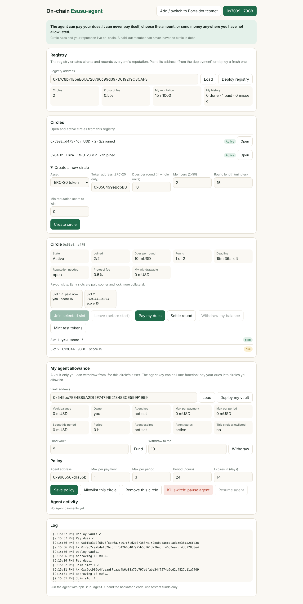
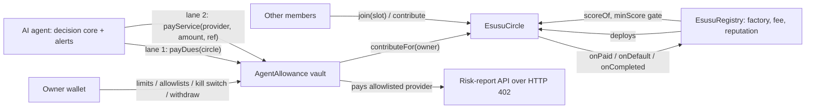

# On-chain Esusu-agent

**Ajo, but nobody can run away with the pot. And an AI agent pays your dues without ever being able to steal.**

   

Built for the **Portaldot Hacker House 2026** (Ecosystem DApps). **Status: complete and tested on local chains; Portaldot testnet deployment in progress** (see [Status](#status-read-this-first)).

| Try it | How |
|---|---|
| **Live app** | _link appears here after the first testnet deploy and Pages setup_ (see [docs/DEPLOY.md](docs/DEPLOY.md)) |
| **60-second local demo, no wallet or tokens needed** | `npm install && npm run demo:local`, then open http://127.0.0.1:5173 ([judge guide](docs/JUDGES.md)) |
| **Prove it works** | `npm test` (101 tests incl. 40 randomized circles) · `npm run e2e` (real browser) |

## Understand it in 10 seconds

- **The problem.** Esusu / ajo circles (everyone pays in, one member takes the pot each round) are how many Nigerians save. They run on trust and a WhatsApp group, and they break when someone takes the pot and disappears. Digital versions can't rely on community shame once members are strangers ([e-MFP](https://www.e-mfp.eu/blog/when-fintech-meets-traditional-informal-financial-schemes-recent-trends-innovations-digitising)).
- **The fix.** The circle's rules live on-chain. Whoever is paid early locks more collateral, so **a paid-out member can never leave the circle in debt**. A missed payment is covered by collateral, the member takes a strike, and a **portable reputation score** (usable by any app) updates.
- **The twist.** Your **AI agent pays your dues on time** from a vault you fund. It can only pay circles and service providers **you** allowlisted, inside limits **you** set, and it can **never withdraw or pay itself**. You can kill it in one transaction.
- **Why Portaldot.** Solidity contracts on Portaldot V3's EVM, with a native `5…` / `0x…` address toolkit and a Remix + Hardhat deploy path we built and documented for other teams.

## Status (read this first)

| Piece | State |
|---|---|
| 3 contracts (`EsusuCircle`, `EsusuRegistry`, `AgentAllowance`) | Built. 101 tests incl. 40 randomized full circles checking solvency after every transaction. Unaudited. |
| Agent (decision core, auto-discovery, Telegram alerts, risk grader) | Built and tested against a real local chain. |
| Paid API: agent buys a risk report over HTTP 402 from its capped vault | Built and tested end to end (local). |
| Dapp (read-only mode, slot picker, risk grade, stablecoin flows, vault controls) | Built. 39 checks pass in headless Chromium against a local chain. |
| One-command judge demo with seeded circles, a defaulter, a gated circle and a live agent | Built and run end to end. |
| **Portaldot testnet deployment** | **Not done yet.** Our build sandbox cannot reach Portaldot. Deploy kit, wallet tool and guide are ready: [docs/DEPLOY.md](docs/DEPLOY.md). No testnet addresses are claimed anywhere in this repo until they exist. |
| Portaldot **WASM / ink!** | **Not used.** Shown honestly as roadmap, not claimed. |
| Third-party audit | Not done. Self-audit log: [docs/AUDIT.md](docs/AUDIT.md). |

## How it works

**Slot-priced collateral.** In a circle of `n`, slot `s` (0 = paid first) locks `dues × max(1, n−1−s)`. After being paid, a member still owes `n−1−s` more rounds, which the collateral covers exactly. The randomized tests check this holds after every transaction.

## Both ideas, fully built

| Idea | What was asked | Where it is |
|---|---|---|
| **1. Esusu / ajo on-chain** | Rotating savings, escrowed contributions, payout order, default penalties | Circles with chosen payout slots, collateral, slashing, strike rule, pull payouts, ERC-20 stable dues, leave-before-start, reputation gating, 0.5% fee (cap 2%) |
| **2. Agent allowance** | Wallet for AI agents with spend limits, whitelisted targets, kill switch, a demo agent that **pays for APIs** | `AgentAllowance`: per-payment and per-period caps, per-provider caps, allowlists, expiry, pause, can't pay itself. Demo agent pays a risk-report API over HTTP 402 (`npm run demo:buy`) |

## What the agent can and cannot do (enforced on-chain)

| Can | Cannot |
|---|---|
| Pay your dues into circles **you** allowlisted (amount read from the circle, beneficiary always you) | Choose that amount, or pay anyone for you but you |
| Pay providers **you** allowlisted, within per-payment, per-provider and per-period caps | Pay an address you did not allowlist, or **itself** |
| Settle finished rounds (anyone can) and alert you early | Withdraw, change limits, un-pause, allowlist anything, or act after expiry |
| | Worst case if its key is stolen: your own dues pre-paid, plus at most one period's cap to providers you already trust, until you press pause |

## What we contribute to the Portaldot ecosystem

1. **A `0x…` → native `5…` address helper**, verified byte-for-byte against the official guide's example ([`lib/portaldot.js`](lib/portaldot.js)). Newcomers need this just to claim test tokens.
2. **A deploy kit**: local wallet generator, RPC/balance preflight, gas overrides, Remix flatten fallback, and a step-by-step guide for the pitfalls other builders reported ([docs/DEPLOY.md](docs/DEPLOY.md)).
3. **A reusable on-chain reputation registry** any Portaldot dapp can read with `scoreOf(address)`.
4. **The bounded-agent vault pattern**, including HTTP 402 payments from an AI agent, as open-source reference code.

## Measured (all local, reproducible)

| Claim | Result | Command |
|---|---|---|
| Contracts + agent + service tests | 101 passing (61 + 40 random circles) | `npm test` |
| Random circles (2 to 8 members, native or ERC-20, random fees, defaults, vanishing members): solvency and debtor-safety asserted after every transaction, no stuck funds | 40 passing (`FUZZ_RUNS=500 npm run test:fuzz` for more) | `npm run test:fuzz` |
| The fuzz suite can fail: breaking collateral pricing fails 31/40, breaking slashing fails 38/40 | Mutation-checked by hand | edit `collateralFor` or the `pot[r] += cut` line |
| Real-browser end to end: create / join / pay / settle / withdraw, vault and kill switch, ERC-20 approvals, read-only mode, provider allowlist | 39 checks | `npm run e2e` |
| Settlement gas grows linearly: about 0.45M at 12 members, 0.78M at 24 (hence the 30-member cap) | measured | see [AUDIT](docs/AUDIT.md) |

## Docs

[Judge guide](docs/JUDGES.md) · [Architecture and invariants](ARCHITECTURE.md) · [Self-audit](docs/AUDIT.md) · [Deploy to Portaldot](docs/DEPLOY.md) · [Roadmap](ROADMAP.md) · [Grant and sponsor brief](docs/GRANTS.md) · [Business model](docs/BUSINESS.md) · [3-minute demo script](docs/DEMO_SCRIPT.md) · [Security policy](SECURITY.md) · [Contributing](CONTRIBUTING.md)

## Limitations, stated plainly

- **Not audited.** Do not use real funds. Residual design risks (late-slot early defaults, Sybil reputation, first-come slots) are in [docs/AUDIT.md](docs/AUDIT.md).
- **Nothing has run on Portaldot testnet yet.** Reported chain quirks (inflated gas estimates, raw EVM transactions rejected for one team, native 14 vs EVM 18 decimals, missing logs for native-path calls) are unverified by us and handled with fallbacks in the deploy guide.
- A strike is permanent: a member who misses once forfeits their payout slot even if they keep paying.
- The risk grade is a transparent heuristic, not a prediction.
- Only native tokens and well-behaved ERC-20s are supported; fee-on-transfer tokens are rejected (tested).
- The paid-API verifier is token-based (ERC-20); the native-coin path is not implemented.

## Disclosures

Third-party: Hardhat, ethers v6, OpenZeppelin Contracts 5.0.2, dotenv, solc-js, playwright-core (tests only). The agent's optional plain-language explanations use the Anthropic API and never influence a decision. Hackathon-period code (Oct 2026), MIT licensed. Not financial advice.
