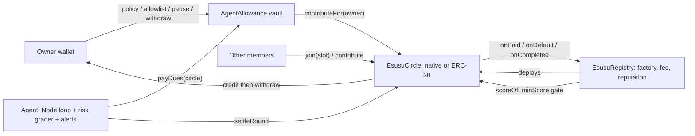

# On-chain Esusu-agent: savings circles with portable reputation and an AI agent that can only pay your dues

**Built for the Portaldot Hacker House 2026 (Track: Ecosystem DApps).**

**Links:** Live demo: _pending_ · Demo video: _pending_ · Pitch deck: _pending_ · Registry / contracts: _pending testnet deploy_ · Explorer: https://node-console.portaldot.dev/ · [Self-audit](docs/AUDIT.md) · [Architecture](ARCHITECTURE.md)

> **The agent can pay your esusu dues. It can never pay itself, choose the amount, or send money anywhere you have not allowlisted. And a member who has been paid out can never leave the circle in debt.**

Esusu (ajo, ROSCA) is how tens of millions of people in Nigeria save: everyone pays in each round and one member takes the pot, in turn. It runs on a WhatsApp group and trust, and it breaks when someone takes their payout and disappears. This project moves the rules on-chain and adds two things a WhatsApp group cannot do:

1. **Debtor-safe circles.** Collateral is priced by payout slot: `dues x max(1, size-1-slot)`. Whoever is paid early locks more, exactly covering what they still owe. Missed rounds slash collateral into the pot; a defaulter forfeits their slot. Randomized simulations check this after every transaction.
2. **A portable reputation score** (`EsusuRegistry.scoreOf`, 0-1000) written only by circles the registry deployed. Circles can require a minimum score, so a good saver carries credit between circles and other apps can read it.
3. **An agent that cannot steal.** `AgentAllowance` is a vault the owner funds. The agent key can call exactly one function: pay the owner's dues into an owner-allowlisted circle, in the same asset, within per-payment and per-period caps, until it expires, unless paused. The amount comes from the circle, the beneficiary is always the owner.

## How it works

The agent's `decide()` is a pure function (no LLM): `pay | settle | wait | alert | idle`. It alerts the owner on Telegram (optional) *before* a deadline if it cannot pay (vault empty, paused, expired, not allowlisted). An LLM may write a one-sentence explanation after the fact; it never makes a decision.

## What's used, and what's deliberately not
| Surface | Used | Evidence / reason |
|---|---|---|
| Portaldot V3 EVM (chain 420420777), Solidity 0.8.24 | Yes, deploy pending | `scripts/deploy.js` writes `deployments/portaldot.json` |
| Native POT and any ERC-20 (stable-value dues) | Yes | ERC-20 suite, browser test, fee-on-transfer tokens rejected |
| OpenZeppelin (ReentrancyGuard, SafeERC20, Ownable) | Yes | disclosed below |
| Portaldot WASM / ink! | **Not used** | No honest interop to claim yet; see ARCHITECTURE.md "Open question" |
| Cross-chain | No | Out of scope |

## The thesis, enforced (not asserted)
| The system decides | The system is structurally prevented from deciding |
|---|---|
| When to pay (agent policy) | The amount (read from `circle.dues()`) |
| Which allowlisted circle to pay | Any non-allowlisted or different-asset destination |
| Settling a finished round | Who benefits (always the vault owner) |
| Nothing else | Withdrawing, changing policy, un-pausing, acting after expiry |
| | A paid-out member leaving with less collateral than they still owe (invariant I10) |

## Measured
| Claim | Result | Reproduce with |
|---|---|---|
| Unit, integration and agent tests | 35 passing | `SOLC_JS=1 npx hardhat test` |
| 40 seeded random circles (2-8 members, native or ERC-20, random fees, defaults, vanishing members): solvency and debtor-safety asserted after **every** transaction, zero stuck funds | 40 passing | `SOLC_JS=1 npx hardhat test test/fuzz.test.js` (`FUZZ_RUNS=500` for more) |
| The fuzz suite can fail: with collateral pricing broken it fails 31/40; with slashing not added to the pot it fails 38/40 | Mutation-checked once by hand | edit `collateralFor` / the `pot[r] += cut` line and rerun |
| The dapp works in a real browser: create/join/pay/settle/withdraw, vault deploy/fund/policy/allowlist/kill switch, ERC-20 approve flows | 32 checks pass | `SOLC_JS=1 node scripts/e2e-browser.js` (needs Chromium; writes `docs/dapp-e2e.png`) |

These ran against local Hardhat chains. **Nothing has run on Portaldot testnet yet.**

## Try it in 30 seconds (local)
```bash
npm install
SOLC_JS=1 npx hardhat test                 # omit SOLC_JS=1 on a machine with normal internet
SOLC_JS=1 npx hardhat run scripts/demo.js  # guardrails, defaulter slashing, kill switch, reputation
npm run compile && npm run web             # dapp at http://localhost:5173
node agent/risk.js <circleAddress> [slot]  # pre-join risk grade for a circle
```

## Deploy to Portaldot testnet
Full guide (wallet creation, claiming test POT, Hardhat and Remix routes, troubleshooting): **[docs/DEPLOY.md](docs/DEPLOY.md)**.
```bash
npm run wallet        # creates owner + agent keys locally, prints the 0x and the native 5... addresses
# request test POT for the 5... address (docs/DEPLOY.md step 3), then:
npm run preflight     # RPC, chain id, balance
npm run deploy:testnet
npm run agent
```
RPC `https://test-evm-rpc-v3.portaldot.dev`, chain ID `420420777`, symbol `tPOTv3`.

## Business model
0.5% protocol fee on payouts (hard cap 2%, set per registry, paid to a treasury), charged only when a circle completes a payout. Reputation reads are free, which is the ecosystem hook: lenders and other dapps can gate on `scoreOf`.

## Limitations, stated plainly
- **Not audited** by a third party. Do not use real funds. See [docs/AUDIT.md](docs/AUDIT.md) for what was found and fixed, and the residual risks.
- Members who default **before** being paid are only covered by their collateral (one `dues` per missed round). A very early miss by a late-slot member (floor collateral of one `dues`) can shorten later pots; the shortfall is explicit and the contract stays solvent, but the recipient absorbs it. Use `minScore` gating for higher-trust circles.
- Reputation can be inflated by Sybil circles among friends. It is a signal, not proof of personhood.
- Slots are chosen first-come; there is no auction or randomisation.
- Settlement is permissionless but someone (the agent or a member) must call `settleRound`; there is no on-chain keeper.
- The risk grade is a transparent heuristic, not a prediction.
- Only the native token and well-behaved ERC-20s are supported (fee-on-transfer and rebasing tokens are rejected or unsupported).
- Portaldot testnet behaviour (gas, finality, log-query limits) is unverified until the first deploy.

## Disclosures
Third-party: Hardhat, ethers v6, dotenv, solc-js, playwright-core (tests only), OpenZeppelin Contracts 5.0.2. Agent explanation text optionally uses the Anthropic API. Hackathon-period code (Oct 2026). Not financial advice.
